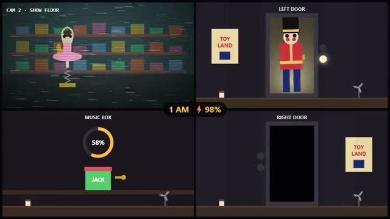

# Night Shift

Guard the toy shop until 6 AM. Shut the doors. A multiplayer starter game from [Multiplayer Agent](https://multiplayeragent.com): 2D, co-op, 1–4 players, with bots that run the stations nobody has taken.

## How it plays

The wind-up toys walk at night. Split the guard stations: one watches the cameras, two hold the doors and one keeps the music box playing. Doors and lights eat power, so shut them only when something is there.

- **Cameras:** five feeds of the shop. Whatever you see is called out to the whole team. The Ballerina can't move while a camera is on her.
- **Left and right door:** you only see who's standing there with the light on. Listen for footsteps, light up, and shut the door in time. A blocked toy bangs and goes back down the hall.
- **Music box:** keep it wound. If the music stops for too long, Jack pops out.
- If the power runs out, every door opens and the lights die. Make it to 6 AM and the next night is harder.

**Controls:** 1–4 picks a station, Space shuts the door, winds or flips the camera, hold L for the door light, or tap the buttons.

## Make it yours in the Game Builder

Open the [Game Builder](https://multiplayeragent.com), choose **Start from a starter game** and pick Night Shift. It opens as version 1 in your studio, ready to play and publish. Then ask for changes, for example:

- Add a fifth toy that crawls through the air vent
- Make the power come back a little at 3 AM
- Add a hiding mask that fools the Ballerina

## Run it yourself

1. Get a free publishable key (`pk_…`) at [multiplayeragent.com](https://multiplayeragent.com).
2. In `index.html`, put it in place of `pk_REPLACE_ME` in the `MP_CONNECT` block.
3. Open `index.html` in a browser. No build step and no server needed.

Without a key it still runs, offline with bots at the other stations.

## How it is built

- One `index.html`. The comment at the top of the script maps the code and explains the multiplayer.
- **Host-run rules:** The host's browser moves the toys, drains the power and runs the clock; if it leaves, the next player takes over.
- **Bots:** Bots run every station nobody has taken, so you can play alone.
- **Live sync:** Every door, light and camera switch shows for the whole team at once.
- **Leaderboard:** The most nights survived.
- `?attract` runs it offline with bots only, showing all four stations at once. The preview video is recorded from it.

## License

MIT.
